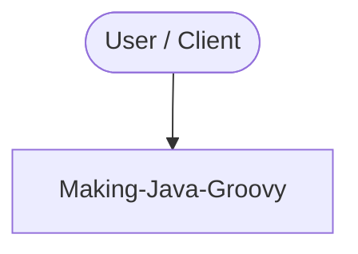

# Context Map — `Making-Java-Groovy`

> Auto-generated architecture & deployment context map. Summarizes the core application, container/cloud footprint, and database connections. Regenerate after significant structural changes.

**Repo:** `avnit/Making-Java-Groovy` · **Fork** · Public · Primary language: Groovy · Default branch: `master` · Files: 924

**Description:** Source code for Manning book "Making Java Groovy"

## 1. Core application

Source code for [Making Java Groovy](http://manning.com/kousen) by Ken Kousen

- **Listens on port(s):** 22, 25, 1234, 8163

## 2. Containers & cloud applications

_No container, Kubernetes, IaC, or cloud-deploy manifests detected. Runs as a local script/library or static site._

## 3. Database connections

_No database drivers or connection strings detected._

## 4. Architecture diagram

## 5. Security posture

- **Dependabot alerts (open):** 4 critical, 4 medium
- **Static scan findings:** 1 critical, 1 medium

| Severity | Rule | File:Line |
|---|---|---|
| critical | gcp-api-key | `ch02/groovybaseball/src/main/groovy/service/Geocoder.groovy:23` |
| medium | js-innerhtml | `ch02/groovybaseball/src/main/webapp/js/calendarview.js:472` |

---
_Generated by repo context-mapping pass on 2026-08-13._